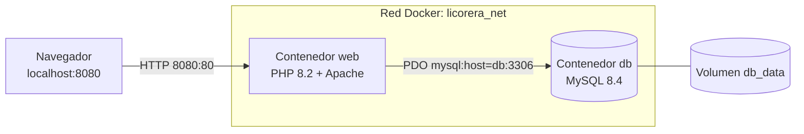

# Licorera JP – Docker + Docker Compose

Tienda web de licores (PHP + Apache) conectada a una base de datos MySQL. Cada pieza corre en su propio contenedor y se comunican por una red de Docker usando el nombre del servicio (`db`).

## Arquitectura



| Servicio | Imagen | Rol | Puerto |
|----------|--------|-----|--------|
| `web` | `php:8.2-apache` (Dockerfile propio) | Aplicación (tienda, login, pedidos) | 8080 → 80 |
| `db`  | `mysql:8.4` | Base de datos (usuarios, pedidos) | 3306 solo interno |

## Estructura del repositorio

```
.
├── web/                    # Servicio 1: aplicación
│   ├── Dockerfile
│   ├── .dockerignore
│   ├── php/custom.ini      # Ajustes de PHP
│   └── src/                # Código PHP, CSS, JS e imágenes
├── db/
│   └── init.sql            # Tablas (se ejecuta al crear el volumen)
├── .github/workflows/ci.yml
├── docker-compose.yml
├── .env.example            # Plantilla de variables 
└── .gitignore              # Excluye .env
```

## Requisitos

- Docker Desktop y Git.

## Cómo levantar el proyecto

```bash
# 1. Clonar el repositorio
git clone https://github.com/TU_USUARIO/licorera-docker.git
cd licorera-docker

# 2. Crear el archivo de variables y editar las contraseñas
cp .env.example .env          

# 3. Construir las imágenes y levantar los contenedores
docker compose up --build -d

# 4. Ver el estado
docker compose ps
```

Abrir en el navegador:

- Tienda: <http://localhost:8080>
- Registro / login: <http://localhost:8080/ingresar.php>
- Prueba de comunicación web ↔ db: <http://localhost:8080/prueba_db.php>

## Prueba de comunicación (punto central)

La página `prueba_db.php` demuestra una operación de ida y vuelta: el contenedor `web` guarda un dato en MySQL y luego lo lee. Muestra el host usado (`db`) y los identificadores de ambos contenedores. También se puede comprobar por línea de comandos:

```bash
# Quién es "db" desde el contenedor web 
docker compose exec web getent hosts db

# Ver los datos guardados directamente en MySQL (pide la contraseña root del .env)
docker compose exec db mysql -uroot -p licorera -e "SELECT * FROM prueba_comunicacion;"

# Ver los dos contenedores dentro de la red
docker network inspect licorera-docker_licorera_net
```

> El nombre de la red tiene como prefijo el nombre de la carpeta del proyecto. Para ver el nombre exacto: `docker network ls`.

## Comandos útiles

```bash
docker compose logs -f            # ver logs
docker compose down               # detener y borrar contenedores 
docker compose down -v            # detener y borrar también el volumen 
docker compose build --no-cache   # reconstruir imágenes desde cero
docker ps                         # contenedores en ejecución
```

## Seguridad y buenas prácticas

- Las contraseñas están en `.env`, que no se sube al repositorio (`.gitignore`). Se incluye `.env.example` como plantilla.
- No hay credenciales en el código: PHP lee `DB_HOST`, `DB_NAME`, `DB_USER` y `DB_PASSWORD` desde variables de entorno.
- Las claves de los usuarios se guardan con `password_hash()` y se validan con `password_verify()`.
- La base de datos no publica puertos hacia el exterior; solo es alcanzable desde la red interna.
- `.dockerignore` evita copiar archivos innecesarios o sensibles a la imagen.
- Imágenes con versión fija (`php:8.2-apache`, `mysql:8.4`).

## Integración continua

El workflow `.github/workflows/ci.yml` se ejecuta en cada `push` y `pull_request`: valida el compose, construye las imágenes, levanta los contenedores y ejecuta la prueba de comunicación `web → db`.
